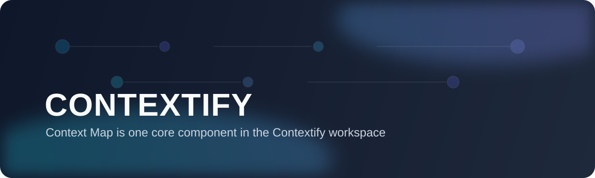

<div align="center">
  
</div>

# Context Map

面向 AI 团队的「对话上下文操作系统」原型。  
将线性聊天升级为可视化主线/分支协作，让复杂任务在多线程对话中可追踪、可回溯、可复用。

## 1. 产品定位（商业原型）

- 产品形态：Web SaaS 原型（当前为本地可运行 MVP）
- 核心问题：AI 对话在长链路任务中容易“漂移”，上下文不可控、决策不可复盘
- 目标用户：`AI 应用团队`（产品经理、提示词工程师、研发）
- 目标用户：`内容与咨询团队`（需要分叉探索 + 汇总结论）
- 核心价值：主线与分支并行探索，不丢上下文
- 核心价值：节点级上下文控制（Include / Exclude）
- 核心价值：将高质量对话沉淀为 SOP Pattern，支持复用

## 2. 核心能力

- 多项目管理：创建/切换/删除项目
- 对话流与图谱联动：左侧 `Projects` + 中间 `Conversation Stream` + 右侧 `Context Map`
- 主线/分支机制：从任意节点 `Re-Branch`、分支提升主线（Promote）、自定义主线起止点
- 上下文编排：节点 Include/Exclude、批量节点上下文切换
- 结构治理：`Undo / Redo` + `Reset to Natural`
- 布局模式：`Tree` / `Mindmap` / `Timeline`
- AI 增强：流式回复、分支主线摘要、SOP Pattern 提取（name / guidance / steps）

## 3. 典型业务场景

- 需求方案评审：同一需求开多个技术分支，最终提升最优路径为主线
- 销售方案生产：同一客户画像拆出多个话术分支，保留最佳转化链路
- 研究任务协作：证据、反证、结论各走分支，最后合并成可追溯结论

## 4. 技术架构

- 前端：React 19 + TypeScript + Vite
- 状态管理：Zustand
- 图谱引擎：React Flow (`@xyflow/react`) + Dagre 自动布局
- AI 接口：OpenAI-Compatible Chat Completions（默认适配 SiliconFlow/DeepSeek）
- UI：TailwindCSS 4 + Lucide Icons

## 5. 快速开始

### 5.1 环境要求

- Node.js 18+
- npm 9+

### 5.2 安装与启动

```bash
npm install
cp .env.example .env.local
npm run dev
```

应用默认启动于：`http://localhost:3000`

## 6. 环境变量

在 `.env.local` 中配置（参考 [.env.example](.env.example)）：

```bash
# 必填（至少一组可用 API Key）
ANTHROPIC_API_KEY=...
ANTHROPIC_BASE_URL=https://api.siliconflow.cn/v1
DEEPSEEK_MODEL=deepseek-ai/DeepSeek-V3.2

# 可选：OpenAI Compatible
SILICONFLOW_API_KEY=...
SILICONFLOW_BASE_URL=https://api.siliconflow.cn/v1

# 可选：检索增强
TAVILY_API_KEY=...
```

说明：
- 代码优先读取 `SILICONFLOW_API_KEY`，否则回退到 `ANTHROPIC_API_KEY`
- `DEEPSEEK_MODEL` 未配置时默认使用 `deepseek-ai/DeepSeek-V3.2`

## 7. 常用脚本

```bash
npm run dev            # 本地开发
npm run build          # 生产构建
npm run preview        # 预览构建产物
npm run lint           # TypeScript 类型检查
npm run test:mainline  # 主线端点与结构回归测试
```

## 8. 当前状态与路线图

### 当前状态（MVP）

- 已完成核心交互闭环：主线/分支/上下文编排/结构回溯/模式提取
- 已提供结构稳定性脚本：`scripts/test-mainline-endpoints.ts`

### 下一阶段（商业化建议）

- 团队协作：多人实时协同、评论、权限管理
- 数据持久化：会话历史、版本快照、工作区隔离
- 可观测性：Token/成本/质量指标看板
- 企业能力：SSO、审计日志、私有化部署

## 9. 项目结构

```text
src/
  components/
    ConversationStream.tsx
    ContextMap.tsx
    ProjectList.tsx
  services/
    gemini.ts
  store.ts
  types.ts
scripts/
  test-mainline-endpoints.ts
```

## 10. License

Apache-2.0（见源码头部声明）。
