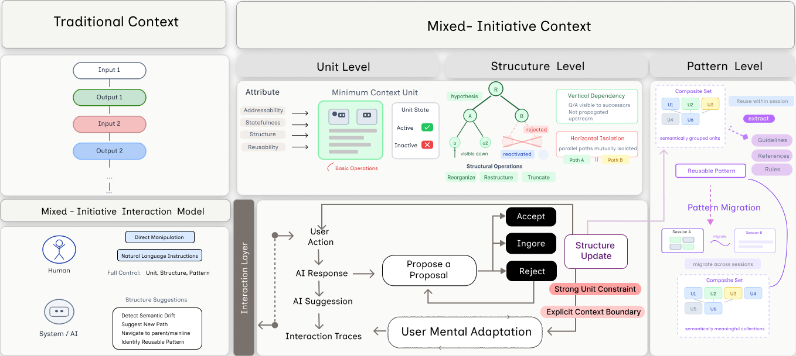
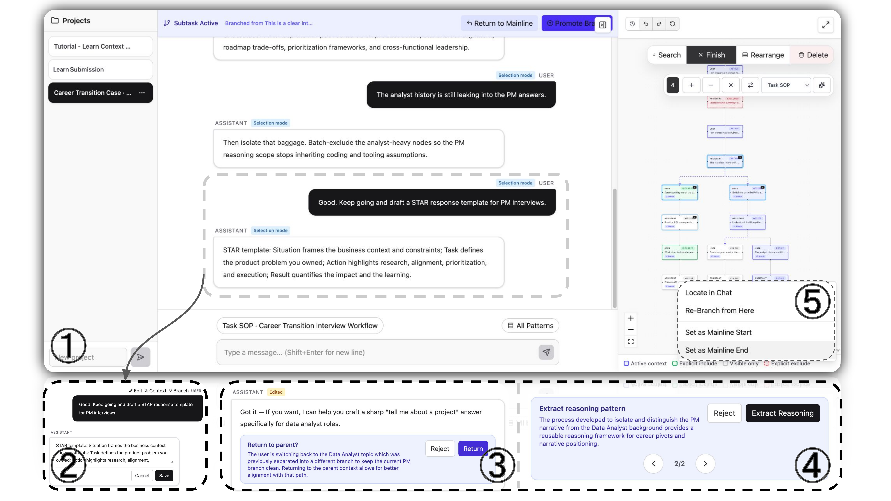
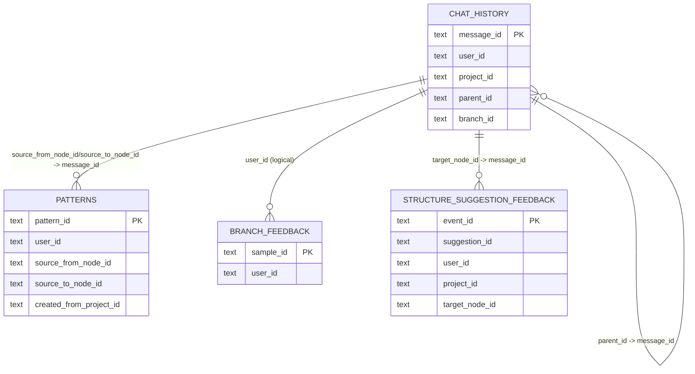

<div align="center">


# Contextify

**Open-source human–AI workspace where conversation context is explicit, structured, and manipulable.**

[](./LICENSE)
[](https://arxiv.org/abs/2604.07121)
[](https://www.youtube.com/watch?v=x7ZAZX5cLYg)

[Quick start](#quick-start) · [Documentation](#documentation) · [Cite the paper](#cite-the-paper) · [Contribute](#contribute)

</div>

---

## What this repository is (name change)

| Name | Meaning |
|------|---------|
| **Contextify** | The **product and open-source project** this README describes (what we ship and iterate on in public). |
| **Context Map** | The **right-hand structured view** inside the app (topology of mainline/branches and node operations). |

Earlier revisions of this README only referred to “Context Map” as the project name. The README you are reading now is intentionally framed around **Contextify** as the public product, while keeping the in-app “Context Map” terminology where the UI uses it.

---

## Why Contextify exists (paper-aligned)

Multi-turn collaboration context is often **flattened into a single chronological sequence** and passed forward as a fixed whole, which makes it hard to **dynamically organize** what should matter for the next step. Contextify explores the **Mixed-Initiative Context** idea: treat accumulated context as something **humans and the model can structure together**—branch, bound, include/exclude, and reuse—instead of only repairing it through new prompts.

Research paper: [Mixed-Initiative Context: Structuring and Managing Context for Human-AI Collaboration](https://arxiv.org/abs/2604.07121) (Haichang Li, Qinshi Zhang, Piaohong Wang, Zhicong Lu).  
Also indexed on alphaXiv: [overview](https://www.alphaxiv.org/overview/2604.07121v1).

---

## Paper Introduction with Figures

The paper-level motivation is that multi-turn context is often flattened into one chronological stream, while real collaboration contains branching, temporary paths, and shifting intent.

### Figure A: Mixed-Initiative Context concept



This concept figure introduces the shift from implicit context handling to explicit context structuring and management, with mixed initiative between human and AI.

### Figure B: Contextify system UI



This UI figure shows the system instantiation of the concept: conversational interaction and Context Map are synchronized, so users can directly operate on context units/structure while AI provides structure-level suggestions.

For full details, see the paper: [arXiv:2604.07121](https://arxiv.org/abs/2604.07121).

---

## TL;DR

| You get | In practice |
|--------|-------------|
| Structured threads | Mainline + **branches** instead of one undifferentiated transcript |
| Scoped reasoning | **Include / Exclude** at node level so irrelevant turns do not pollute the next reply |
| Convergence | **Promote** a branch outcome back to the main line of work |
| Reuse | **Pattern / SOP-style extraction** from successful flows |
| Demo | **Watch:** [YouTube demo](https://www.youtube.com/watch?v=x7ZAZX5cLYg) · **Run locally** below |

---

## Quick start

**Requirements:** Node.js 20+, npm 9+

```bash
npm install
# Export SILICONFLOW_API_KEY in your shell (server-side only).
npm run dev
```

Open **`http://localhost:3000`**.

For all providers, Supabase sync, and deployment: [docs/deployment.md](./docs/deployment.md) · [docs/supabase.md](./docs/supabase.md).

---

## Common scripts

```bash
npm run dev            # local dev
npm run build          # production build
npm run preview       # preview build
npm run lint          # TypeScript check
npm run test:mainline # mainline / structure regression script
npm run test:context-steward # graph, context compiler, preference policy
```

---

## Capabilities (high level)

- **Projects** + **Conversation Stream** + **Context Map** stay in sync
- **Branch / Re-Branch / Promote**, custom mainline start/end
- **Context controls:** per-node include/exclude and batch operations
- **Cross-turn context stewardship:** retrieve relevant material from an earlier branch, review the exact messages, include them in the next turn, and release imported branch material as the task moves on
- **Deterministic context compiler:** active path plus explicit includes minus explicit excludes; records the selected node IDs for each sent turn
- **Local preference learning:** accepted/rejected suggestions and manual plan edits adjust future retrieval sensitivity per user
- **Structure governance:** Undo / Redo, Reset to Natural
- **Layouts:** Canvas / Map / Thread
- **AI:** streaming chat, branch summary, pattern / SOP extraction fields (`name` / guidance / steps)

---

## Stack

React 19 · TypeScript · Vite · Zustand · `@xyflow/react` + Dagre · Tailwind CSS 4 · OpenAI-compatible chat API (see `.env.example`)

The context graph, compiler, and suggestion policy are pure domain functions in `src/domain/`. Local evidence storage is in `src/services/`; the chat and map remain presentation surfaces. See [technical architecture](./docs/technical-architecture.md) for the actual turn flow and current integration boundary.

---

## Data Model (ER Diagram)



Full rigorous version (constraints, indexes, and FK hardening recommendations): [`docs/erd.md`](./docs/erd.md)

---

## Documentation

| Doc | Purpose |
|-----|---------|
| [docs/deployment.md](./docs/deployment.md) | Env vars, providers, Vercel, `vercel dev` |
| [docs/technical-architecture.md](./docs/technical-architecture.md) | Graph, context compiler, stewardship, evidence, and runtime boundary |
| [docs/supabase.md](./docs/supabase.md) | Optional Supabase tables for sync / study logging |
| [docs/erd.md](./docs/erd.md) | Full ERD, keys, logical relations, and FK hardening recommendations |
| [CONTRIBUTING.md](./CONTRIBUTING.md) | How to contribute |
| [CODE_OF_CONDUCT.md](./CODE_OF_CONDUCT.md) | Community expectations |
| [SECURITY.md](./SECURITY.md) | Reporting security issues |
| [sdk/README.md](./sdk/README.md) | SDK workspace for embedding capabilities |

---

## Status & roadmap

**Today:** the standalone chat app supports mainline/branches, explicit context plans, a reviewable cross-branch context steward, per-turn plan records, and preference feedback. The model-backed structure suggestion remains a server-side model call; the [DeepSeek Harness Contextify implementation](https://github.com/haichangcharles/dsh-context-map) is the companion agent-runtime project and is not yet connected to this standalone UI.

**On the roadmap (non-exhaustive):**

- Multi-user collaboration, richer persistence, observability, enterprise-style deployment
- **Continual learning:** extend the local accept/reject and plan-edit evidence with cross-device sync and offline model training
- **Inference integration:** explore wiring the Context Map with **KV cache**-aware serving
- **OpenCode:** explore porting this interaction model into **OpenCode**-style coding workflows

---

## Cite the paper

If Contextify or the Mixed-Initiative Context idea helps your work, please cite:

```bibtex
@article{li2026mixed,
  title={Mixed-Initiative Context: Structuring and Managing Context for Human-AI Collaboration},
  author={Li, Haichang and Zhang, Qinshi and Wang, Piaohong and Lu, Zhicong},
  journal={arXiv preprint arXiv:2604.07121},
  year={2026}
}
```

Attribution and citation policy:

- Keep `NOTICE` in redistributions and derivative works (Apache-2.0 notice flow).
- For academic/research use of this project or concept, cite the paper above.

---

## Contribute

Issues and PRs are welcome. Start with [CONTRIBUTING.md](./CONTRIBUTING.md).

---

## License

[Apache-2.0](./LICENSE). See also [NOTICE](./NOTICE) and [CITATION.cff](./CITATION.cff).
