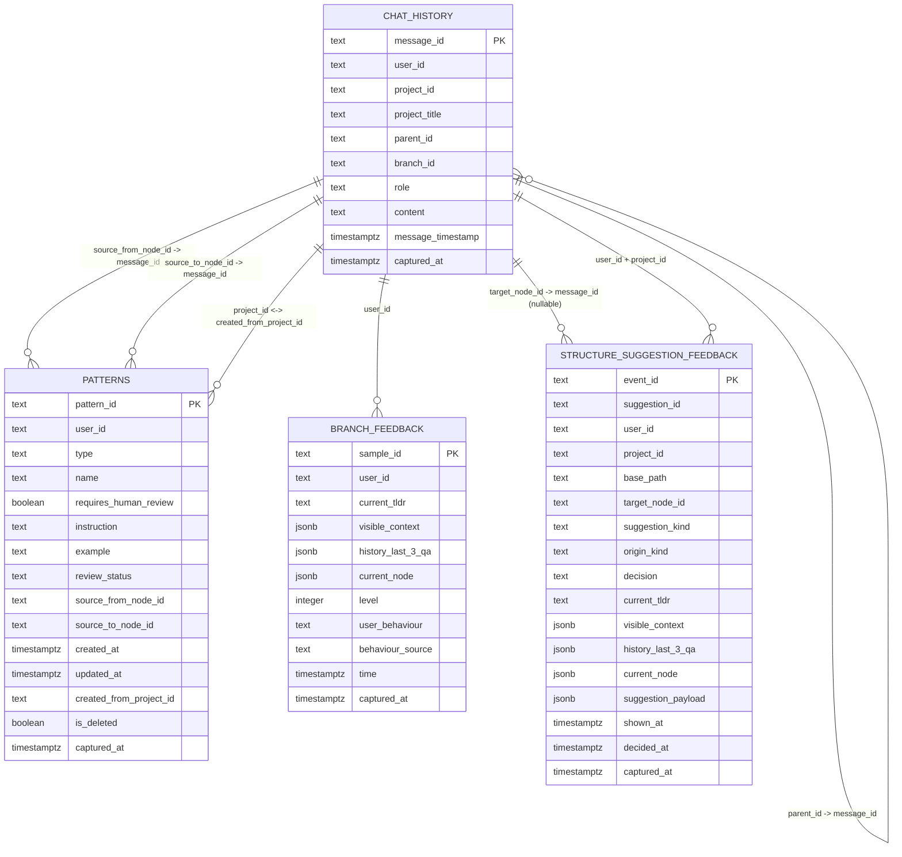

# Contextify Data Model (Rigorous ERD)

This document describes the current Supabase schema in a rigorous format, including:

- table-level entities and key fields
- implemented keys/indexes in SQL
- logical relationships used by the application
- recommended FK constraints for stronger integrity

Source of truth: [`docs/supabase.md`](./supabase.md).

## ER Diagram (Full)

## Implemented Constraints (Current)

- **Primary keys**
  - `chat_history.message_id`
  - `patterns.pattern_id`
  - `branch_feedback.sample_id`
  - `structure_suggestion_feedback.event_id`
- **Secondary indexes**
  - `structure_suggestion_feedback_user_id_idx (user_id)`
  - `structure_suggestion_feedback_suggestion_id_idx (suggestion_id)`
  - `structure_suggestion_feedback_shown_at_idx (shown_at desc)`
- **RLS enabled** on all four tables.

## Logical Relationships Used by App

These relations are used by application logic but are not currently enforced as DB foreign keys:

- `chat_history.parent_id` references `chat_history.message_id` (thread tree)
- `patterns.source_from_node_id` references `chat_history.message_id`
- `patterns.source_to_node_id` references `chat_history.message_id`
- `patterns.created_from_project_id` aligns with `chat_history.project_id`
- `structure_suggestion_feedback.target_node_id` references `chat_history.message_id` (nullable)
- `branch_feedback.user_id` and `structure_suggestion_feedback.user_id` align with `chat_history.user_id`

## Recommended FK Hardening (Optional, Production-Oriented)

If you want stricter integrity for production, consider:

1. Add self-FK on `chat_history.parent_id -> chat_history.message_id` (`ON DELETE SET NULL`).
2. Add FKs from `patterns.source_from_node_id/source_to_node_id -> chat_history.message_id`.
3. Add FK from `structure_suggestion_feedback.target_node_id -> chat_history.message_id`.
4. Introduce canonical dimension tables (e.g., `users`, `projects`) and move `user_id/project_id` to explicit FKs.
5. Add supporting indexes for high-frequency joins:
   - `chat_history(user_id, project_id, message_timestamp)`
   - `patterns(user_id, created_from_project_id, created_at)`
   - `branch_feedback(user_id, time)`

## Notes

- Current schema is consistent with a research/prototype workflow and emphasizes logging flexibility.
- The ERD above intentionally distinguishes implemented keys from logical links, so the model stays rigorous without over-claiming constraints that are not yet in SQL.
